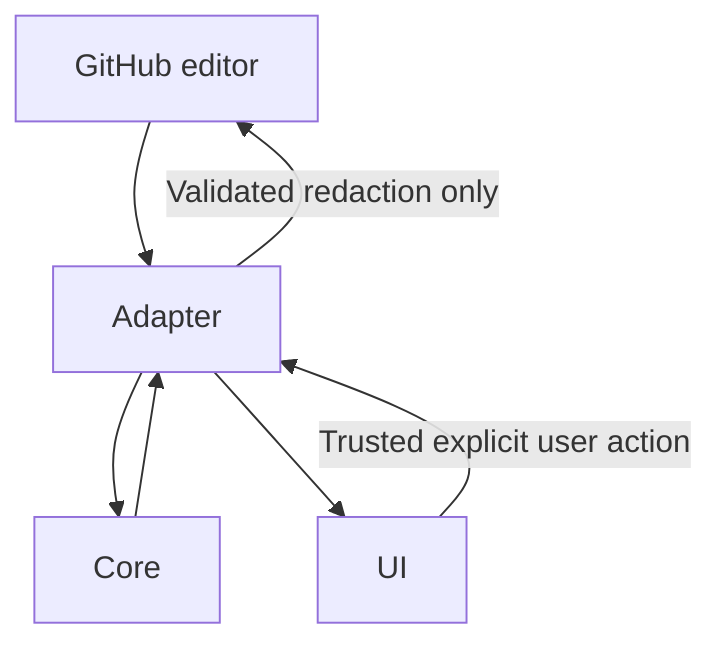
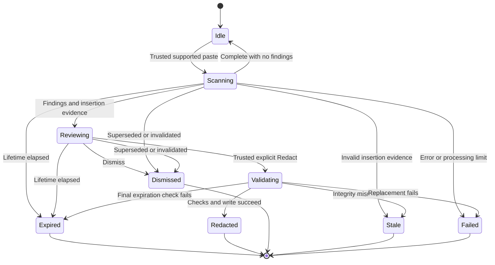
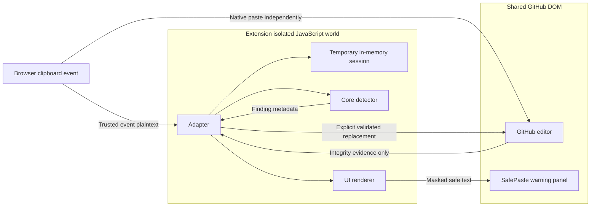

# SafePaste MVP design

Draft for community review — [Issue #1](https://github.com/necoz-oss/safe-paste/issues/1), originating in [Necoz discussion #3](https://github.com/orgs/necoz-oss/discussions/3).

SafePaste helps developers notice potential credentials pasted into public GitHub issues and comments. Following Necoz's **Small. Simple. Useful.** philosophy, the MVP validates **Paste → Detect → Warn → Review → Redact**, with limited detection coverage and no guarantee of safe publication.

The constraints below are the design baseline; implementation choices listed under Open questions remain open. This document does not initialize or implement the extension. Community feedback is welcome before implementation begins.

## Principles and scope

- **Paste-only:** inspect only plaintext from actual, trusted, user-initiated paste events. Never scan existing editor text or monitor regular input, keyboard events, or subsequent edits. Content added or changed afterward is user-controlled and outside detection scope, regardless of intent. This is not a general-purpose input monitor or data loss prevention system.
- **Non-intrusive:** native paste proceeds independently. Never call `preventDefault()`, `stopPropagation()`, or `stopImmediatePropagation()` to interfere with paste; never await detection before allowing insertion, require confirmation, automatically redact, or block submission. Failures must not disrupt GitHub.
- **Performance-first:** bounded, deterministic work; little synchronous work in the paste handler; responsive typing and scrolling. Start without Web Workers and add complexity only when benchmarks justify it.
- **Local-first:** no backend, external API calls, AI, analytics, telemetry, persistent sensitive content, remote executable code, or remote detection rules.
- **User-controlled:** warn only for findings or meaningful processing limitations. Users choose Redact or Dismiss. Best-effort detection cannot certify the final editor content.

### MVP

Chrome Manifest V3, strict TypeScript, `github.com` only, supporting native textarea-based GitHub issue descriptions and issue comment editors. Other surfaces require a later decision.

Only GitHub Classic PATs and Fine-grained PATs are detection targets. GitHub documents the prefixes `ghp_` and `github_pat_` respectively in its [token format reference](https://docs.github.com/en/authentication/keeping-your-account-and-data-secure/about-authentication-to-github#githubs-token-formats). A prefix alone is not a complete token. Future rule work must document full structural matching criteria, boundaries, and limitations using official formats where available; it must never authenticate or verify tokens with GitHub. Exact algorithms remain open. The reviewed reference establishes prefixes, not a complete normative grammar for both token bodies; no unverified length or checksum assumption is finalized here.

### Non-goals

Continuous monitoring, full editor scanning, detection of manual edits, inline textarea highlighting, overlays, custom editors, interrupting modals, automatic redaction, submission blocking, global clipboard monitoring, AI detection, automated bug reports, standalone web/VS Code/Electron apps, other browsers or websites, and general-purpose personal information detection are excluded.

## Workflow and UX

Native paste happens normally while SafePaste independently inspects event plaintext. Findings produce a non-blocking panel associated with that editor, preferably directly below it. Use native DOM APIs, no UI framework, and leave the editor's rendering intact. Do not steal focus or interrupt typing/navigation. Support light/dark themes, keyboard-operable native buttons, meaningful accessible text, visible focus, and warnings conveyed by words as well as color. Announce updates politely without repeatedly interrupting assistive technology.

The panel includes SafePaste's name, the number of potential values, categories, fixed masked previews, Redact and Dismiss, and a short disclaimer. Synthetic display example (not credentials):

```text
SafePaste
2 potential GitHub personal access tokens detected.
Classic PAT: ghp_••••••••
Fine-grained PAT: github_pat_••••••••
[Redact] [Dismiss]
Always review your text before posting.
```

Never expose complete secrets through previews, tooltips, attributes, accessibility labels, hidden elements, or data attributes. Fixed masks identify category without disclosing credential length or suffixes.

Redact explicitly requests replacement of all findings in the current paste session, for example `GITHUB_TOKEN=[REDACTED_GITHUB_PAT]`. Individual selection is deferred. Redaction must originate from an explicit, trusted user interaction: validate [`event.isTrusted`](https://dom.spec.whatwg.org/#dom-event-istrusted) at the UI activation boundary and ignore synthetic or programmatically dispatched activation events. Use native button activation so legitimate keyboard and assistive technology interactions remain supported; do not require pointer-only gestures. The Adapter must still validate the session and editor before writing. Success says “2 detected tokens redacted. Always review your text before posting.” Dismiss leaves content unchanged, removes the panel, and releases session data.

If editor-state validation fails: “The editor content has changed. SafePaste could not apply the redaction. Please review your text manually or paste it again.” Never relocate matches in edited content. No clean-result banner is needed when detection completes without findings.

On expiration, remove or disable Redact and show a concise, non-blocking message: “SafePaste's review session has expired. Please review your text manually or paste it again.” The expired UI retains no sensitive session data and never displays raw values.

## Architecture and responsibilities



| Layer | Responsibility | Boundary |
| --- | --- | --- |
| Core | Pure TypeScript detection rules, findings, ranges, overlap resolution, deterministic redaction | No DOM, Chrome APIs, GitHub behavior, UI, network, or storage |
| Adapter | Supported editor identification, trusted paste/plaintext capture, session coordination, Core/UI calls, validation, explicit replacement, dynamic navigation and editor lifecycle | No detection rules; a small internal session coordinator is sufficient |
| UI | Warnings, masks, actions, stale/failure messages, accessibility and themes | No detection or direct editor writes; delegate actions to Adapter |

Finding metadata must not contain raw detected secrets. Detection results, replacement metadata, error messages, identifiers, and presentation metadata must never retain complete credential values. UI receives only safe presentation metadata and fixed masked previews. Concrete Finding types and API signatures remain open for [Issue #3](https://github.com/necoz-oss/safe-paste/issues/3). Core is independently testable and reusable. Keep module boundaries simple: no monorepo, dependency injection framework, state management framework, premature plugin system, or substantial fourth layer. Minimize runtime dependencies, preferably to zero.

### Core range and overlap contract

All text offsets are zero-indexed UTF-16 code units; all ranges are half-open intervals `[start, end)`. Offsets must be valid integers within the associated source string. Non-empty findings must satisfy `0 <= start < end <= source.length`. This aligns with JavaScript string slicing and native textarea selection APIs.

Neither redaction boundary may split an existing valid UTF-16 surrogate pair. Invalid or corrupted ranges must cause safe rejection before any content modification, without silently normalizing, repairing, or relocating them. SafePaste does not repair pre-existing malformed Unicode. Grapheme cluster handling and Unicode normalization are outside the MVP scope.

Identical inputs and rule configurations must produce deterministic results. Redacting all findings must preserve coverage of every detected sensitive range without unnecessarily modifying unrelated text. For example, with A `[10, 40)` and B `[30, 60)`, silently discarding B would leave `[40, 60)` unredacted. Merging overlapping ranges is one possible strategy, not a finalized implementation. If overlap cannot be resolved safely, reject the replacement and prompt manual review. Sorting priorities, category selection, replacement text selection, and the overlap algorithm remain open for Issue #3.

## Paste sessions and safe redaction

Each editor has at most one active session with its own identity/generation. A new paste supersedes that editor's previous session; other editors remain independent. Capture only necessary clipboard text, editor identity, selection/insertion evidence, validation state, and findings. Do not retain the clipboard event object unnecessarily.

Every paste session must have a finite lifetime measured from its creation, including scanning and review time. Waiting for user interaction must not retain sensitive data indefinitely. A 60-second TTL is a candidate, not a finalized requirement; the duration must balance privacy, usability, accessibility, and simplicity. Expiration invalidates the session, releases unnecessary clipboard text, findings, editor snapshots, and other sensitive references, and prohibits redaction. It never modifies editor content or triggers a scan.

Schedule cleanup on a best-effort basis, accounting for timer throttling and suspended tabs. A delayed timer does not extend session validity: check expiration when execution resumes, in asynchronous callbacks, and immediately before replacement. Exact real-time cleanup is not guaranteed. Lifetime bookkeeping requires no input monitoring or editor polling; the clock and scheduling strategy remain open.

At paste time, capture bounded evidence needed to identify the selection being replaced. After native paste, establish the actual inserted range through a one-time integrity check. Account for newline normalization, selection replacement, and GitHub transformations; clipboard text need not equal inserted text. Detection remains exclusively over captured clipboard plaintext. Mapping clipboard findings to inserted ranges must be unambiguous and verified, without detecting secrets in the editor. Reject unsupported transformations, ambiguous mapping, or intervening changes. Scheduling alone does not prove insertion has finished; compatibility experiments must establish the observation point.

These limited integrity reads at session establishment and an explicit Redact action are not continuous monitoring or additional sensitive-data scans. No editor input/keyboard monitoring or ongoing editor-value polling is permitted; accessible activation of SafePaste controls is separate from editor monitoring. Lifecycle observation may identify removed nodes/navigation without inspecting their text. Bound validation work and retained editor evidence too; large existing editor content must not defeat the paste budget. If safe evidence cannot be obtained within limits, disable redaction and explain the limitation.



Every callback must check session generation and expiration before updating state or UI. Expired sessions cannot be revived by delayed results. Removal, replacement, navigation, or superseding paste invalidates pending results and releases references. No stale result may recreate a panel.

After trusted UI activation, the Adapter must verify the session is active and unexpired, the original editor exists and is the same supported instance/context, its relevant state exactly matches the established post-paste state, and every range still maps consistently to that paste. Apply the Core range and overlap contract to source findings and mapped editor ranges before deterministic replacement, preserving unrelated content. Reject the entire replacement for invalid offsets, split surrogate pairs, or overlaps that cannot be resolved safely; show a non-blocking manual-review message without changing content. Recheck expiration immediately before editor modification, together with integrity checks and the write, without an asynchronous gap. Do not rescan, relocate, fuzzy-match, replace occurrences globally, or merge edits. Any failed check cancels without modifying content.

Without edit monitoring, a state comparison cannot detect an edit followed by restoration to exactly the same state. “Unchanged” therefore means equality at validation, not proof of edit history. The comparison must still make replacement safe. Snapshot representation is open; do not claim a fingerprint alone proves equality. Selection/focus changes caused by clicking Redact must be distinguished from content changes during compatibility work.

Do not finalize the DOM replacement API or undo strategy until GitHub compatibility is investigated. A replacement must preserve GitHub's own state and must not leave a partial edit on failure; supported contexts require evidence of this behavior.

## Security, privacy, and trust boundaries



Clipboard text and shared DOM are untrusted. A trusted event establishes browser provenance, not trustworthy text or a valid credential. Core must treat offsets and inputs defensively. Sessions are temporary sensitive memory; UI receives only safe presentation metadata. Chrome's [isolated world](https://developer.chrome.com/docs/extensions/develop/concepts/content-scripts#work_in_isolated_worlds) separates JavaScript environments, **not the shared DOM**. The page can observe editor text and panel contents; the panel is not a trusted browser-level security prompt. The redaction `isTrusted` check rejects synthetic event dispatch, but is neither a complete security boundary nor proof of user intent; shared-DOM manipulation remains possible. It does not replace Adapter integrity or expiration checks. Shadow DOM may isolate CSS but is not a security boundary.

### Permissions and rendering

Use a statically declared MV3 content script restricted to `https://github.com/*`, then gate processing to supported editors in Adapter. Following Chrome's [minimal permissions guidance](https://developer.chrome.com/docs/extensions/develop/security-privacy/stay-secure#request-minimal-permissions), no `clipboardRead`, `clipboardWrite`, `storage`, `tabs`, `cookies`, `webRequest`, `scripting`, broad host permissions, all-site access, or background service worker is needed. Do not inject into MAIN world without a documented requirement and security review.

Read `text/plain` only from a trusted user paste event's clipboard data; never use global clipboard reads or write secrets to the clipboard. The [Clipboard specification](https://w3c.github.io/clipboard-apis/#clipboard-event-paste) describes paste before insertion and event clipboard access; its editor's draft is not a guarantee of GitHub behavior. Synthetic paste events are ignored.

Construct DOM safely with native APIs and `textContent`; never interpolate clipboard text into `innerHTML`, evaluate it, or expose raw values in hidden DOM or debugging interfaces.

### Data lifecycle and dependencies

Raw source content may remain temporarily available only where required for detection, session integrity validation, and explicit redaction. Avoid unnecessary copies of sensitive source strings and keep them separate from the secret-free finding metadata required above. These constraints do not eliminate all memory disclosure risks. Sensitive content stays local in memory only as long as needed. Prohibit localStorage, sessionStorage, IndexedDB, Chrome Storage, analytics, telemetry, remote error reporting, external API requests, remote rule loading, and secret-bearing console/debug logs or exception messages. No production component intentionally transmits sensitive user data outside the browser.

Release unnecessary references after a clean scan, redaction, dismissal, expiration, invalidation, supersession, editor removal, or navigation; also clean up failed/limited sessions. JavaScript reference release does not guarantee immediate or complete memory erasure. Avoid unnecessary copies and retain no sensitive data in terminal UI messages.

Review third-party packages before adoption. When Issue #2 establishes tooling, commit lockfiles and use reproducible installs. Security-sensitive changes require review and automated checks. Use only synthetic, non-functional fixtures, never issued credentials. No CI or dependencies are introduced by this design.

### Detection safety and known limitations

Bound scan size, findings, rendered entries, and session resources. Handle malformed token-like text, Unicode, multiline content, invalid offsets, and overlaps deterministically. Avoid regex backtracking that permits ReDoS; checking elapsed time after a catastrophic synchronous regex cannot interrupt it. Limit breaches must never look like clean results.

Native paste is intentionally non-blocking: secrets may reach the editor before warnings, and GitHub scripts or other extensions may access them. SafePaste cannot prevent draft persistence or other GitHub behavior. Users may submit before detection, dismiss warnings, or restore secrets through undo. Detection can miss credentials; redaction does not revoke or rotate them. Unsupported workflows and subsequent edits are unprotected. SafePaste does not prevent all disclosure or guarantee safe publication.

## Performance and limits

The product target is **within 1,000 ms** from paste event to final detection result and warning rendering when applicable, including handler, Core, and session coordination. This is not a guaranteed deadline. Record rendering latency through a documented paint-observation method, not merely DOM insertion.

Provisional engineering targets, subject to measurement:

| Metric | Proposed target |
| --- | --- |
| Typical paste | Within 100 ms |
| Individual synchronous main-thread tasks | Approximately 16 ms or less where practical |
| Scan budget | 102,400 UTF-16 code units |
| Findings and rendered entries | Finite caps, exact values open |

Use `string.length` to check the input budget in UTF-16 code units. This limit is not an exact measurement of memory consumption and alone does not guarantee bounded execution time or memory consumption. If an input exceeds budget, the initial conservative policy is to skip detection and explain the limit. If a findings cap interrupts detection, label it incomplete and offer manual review; do not enable session redaction for an incomplete result. The final input limit remains subject to future benchmarks, and final finding caps remain open.

Benchmark synthetic snippets, typical errors, multiline stack traces, large logs, no/multiple findings, malformed tokens, near/over-limit text, and adversarial regex inputs. Include large existing editor values and simultaneous editors. Measure handler duration, Core duration, end-to-end rendering, and main-thread blocking; report p50, p95, and maximum with sample counts. Document Chrome/extension versions, OS, CPU, memory, power/throttling settings, editor context, input sizes, warmup, repetitions, and timing method. No results exist yet.

Promises, async/await, and timers defer work but do not move CPU processing off the main thread. Begin with lightweight bounded algorithms. Only measured failure to meet responsiveness goals justifies Workers or other scheduling complexity.

## Error handling

| Condition | Behavior |
| --- | --- |
| Unsupported editor or untrusted event | Ignore; no success claim or editor change |
| Missing/empty plaintext | Skip; communicate unavailable nonempty plaintext when meaningful, without claiming a clean scan |
| Detection failure | Non-blocking generic failure/manual-review message; release data |
| Size or finding limit | Explicit incomplete/skipped message, no clean result and no redaction |
| Expired session | Release sensitive references; show the expiration message; no replacement or rescan |
| Synthetic redaction activation | Ignore at the UI boundary; do not invoke replacement |
| Stale state or ambiguous insertion | Cancel replacement; show stale/manual-review message |
| Removed/replaced editor or navigation | Dispose session/UI; never write to replacement editor |
| Invalid ranges or unsafe overlaps | Reject replacement before any write; prompt manual review without repairing or relocating ranges |
| Redaction failure | Generic manual-review message; no success confirmation or partial replacement |
| Concurrent pastes | Independent editors; same-editor paste supersedes previous session |
| Result after invalidation or expiration | Discard silently, without recreating UI |

All errors are content-free and leave native GitHub behavior independent.

## Roadmap

1. Review this design under Issue #1, including insertion validation feasibility.
2. Initialize the development environment in Issue #2; no tooling decisions are finalized here.
3. Discuss Core API/rules in subsequent issues; test PAT detection and deterministic redaction independently.
4. Establish supported textarea compatibility, insertion mapping and undo behavior; connect Adapter and framework-free UI.
5. Verify Chrome integration, privacy, failure handling and benchmarks against the acceptance checklist before expanding coverage.

| Stage | Coverage |
| --- | --- |
| MVP | Classic and Fine-grained GitHub PATs only; validate the complete workflow |
| P0, after workflow validation | Gradually add OpenAI API keys, AWS Access Key IDs, Bearer tokens, JWTs, PEM private keys, email addresses, Windows/Linux/macOS user directory paths |
| P1 candidates | Database connection strings, cookies/session credentials, additional service-specific API keys |
| Out of scope by default | IP addresses, phone numbers, generic UUIDs/URLs, person names, arbitrary PII |

Each new detector needs independent tests and documented limitations. AWS Access Key IDs are identifiers, not equivalent to secret access keys. Path masking should preserve useful debugging context where possible, while acknowledging other path components may remain sensitive. Reconsider excluded categories only for concrete developer use cases; becoming a general PII platform requires an explicit product decision.

## Future testing strategy

No tests are implemented by this documentation task.

| Area | Required coverage |
| --- | --- |
| Core | Structurally valid synthetic Classic/Fine-grained examples; invalid/incomplete strings and false positives; multiple/adjacent/overlapping matches; Unicode/multiline text; invalid offsets; correct redaction and unrelated-content preservation; performance/adversarial inputs |
| Adapter | Trusted browser paste and ignored synthetic events; unsupported editors; uninterrupted native paste; no regular-input monitoring or scanning existing/subsequently edited text; selection replacement and normalization; multiple editors/repeated pastes; stale rejection and result ordering; removal/replacement/navigation; safe replacement and failure cleanup |
| UI | Warning/masked previews; Redact/Dismiss/stale messages; keyboard accessibility; light/dark themes; no raw secrets anywhere in generated DOM; malicious HTML-like content rendered safely |
| Security/integration | No extension-initiated external communication, sensitive persistence or console output; minimal permissions; actual Chrome extension on GitHub; native paste, editor state synchronization, undo limitations, and end-to-end performance |

Add Core contract tests for:

- Input lengths below, equal to, and above the configured limit, using ASCII, Japanese and other Unicode text, and astral characters including emojis. Verify `string.length` counts UTF-16 code units correctly, detection is skipped above the limit, and skipped or incomplete detection is reported explicitly rather than as a clean result.
- Zero-indexed UTF-16 offsets and half-open slicing, including string endpoints; reject fractional, non-finite, negative, reversed, empty finding, and out-of-bounds ranges.
- Emojis and other astral Unicode characters before, within, and after ranges; reject start or end boundaries inside surrogate pairs and preserve surrounding text. Do not repair pre-existing malformed Unicode. Verify mapped textarea ranges follow the same rules.
- Identical, nested, partially overlapping, and transitively overlapping ranges, plus adjacent non-overlapping ranges. Verify deterministic output for identical inputs/configurations, complete sensitive-range coverage, preservation of unrelated content, and safe rejection of invalid or unresolvable ranges without partial writes.
- No raw synthetic credential values in detection results, replacement metadata, identifiers, errors, or UI presentation metadata; previews remain fixed masks.

Add lifetime tests during scanning, review, and validation: expiration releases sensitive references, preserves editor content, triggers no scan or input monitoring, rejects redaction at the final pre-write check, and cannot be reversed by delayed results. Simulate throttled timers and suspended/resumed tabs; validity must not depend on timely cleanup. Verify expired UI contains no sensitive data.

Test rejection of `dispatchEvent()` and programmatic `.click()` attempts to redact, and successful native pointer, keyboard, and assistive technology activation followed by Adapter validation. Verify a trusted activation still fails for stale or expired sessions.

Trusted-event integration tests must use actual browser paste and control activation automation/manual testing; dispatching a synthetic event does not establish trusted native paste behavior. All fixtures are synthetic and non-functional.

## MVP acceptance criteria

- [ ] Works as a Chrome Manifest V3 extension.
- [ ] Recognizes supported GitHub issue and comment editors.
- [ ] Inspects only pasted plaintext.
- [ ] Detects GitHub Classic PATs.
- [ ] Detects GitHub Fine-grained PATs.
- [ ] Does not interrupt or delay native paste pending detection.
- [ ] Displays non-blocking warnings.
- [ ] Displays detected values only as masked previews.
- [ ] Requires trusted explicit redaction, rejects synthetic activation, and supports keyboard and assistive technology activation.
- [ ] Allows dismissal.
- [ ] Does not scan subsequent manual edits.
- [ ] Prevents stale sessions from causing incorrect replacement.
- [ ] Enforces finite session validity, rechecks expiration before replacement, and schedules sensitive-reference cleanup without rescanning or modifying content; delayed results cannot revive expired sessions.
- [ ] Targets completion within 1,000 ms under documented conditions.
- [ ] Communicates limits and failures accurately.
- [ ] Does not persist or transmit sensitive content.
- [ ] Requires no unnecessary extension permissions.
- [ ] Clearly documents detection limitations.
- [ ] Keeps Core independent of browser and GitHub APIs.
- [ ] Uses valid UTF-16 half-open ranges and rejects invalid or surrogate-splitting boundaries before replacement.
- [ ] Keeps raw secrets out of finding and presentation metadata.
- [ ] Resolves overlaps deterministically without losing sensitive-range coverage or unnecessarily modifying unrelated content, or safely rejects replacement.

## Open questions and verification status

Community decisions remain open: concrete Core signatures and result types; rule registration; exact PAT matching algorithms; concrete range representation under the fixed UTF-16 contract; overlap sorting priorities, category/replacement selection, and resolution algorithm; supported selectors; DOM replacement and undo integration; snapshot representation, exact finite session duration, and expiration implementation strategy; panel DOM and CSS/Shadow DOM isolation; final size/finding limits; benchmark environment; build tooling and development dependencies.

These choices must satisfy the fixed paste-only, non-blocking, local-only, three-layer constraints, trusted redaction requirement, mandatory finite session lifetime, and the Core range, metadata, and coverage-preservation contract. Concrete Core API decisions belong in Issue #3. In particular, GitHub transformation mapping, post-paste observation timing, and safe replacement/undo compatibility need browser investigation before any editor is declared supported. No selector or replacement API is assumed proven.

Repository inspection found only README and MIT license, with no contribution guide or implementation. Issue #1 was reviewed; the original organization discussion could not be retrieved through the attempted GitHub API and web access. Its detailed consensus is therefore unverified; this draft follows Issue #1 and the supplied task requirements. Official Chrome, Clipboard, and GitHub references above were reviewed on 2026-11-15. Prefix documentation is verified; complete PAT grammars and browser integration remain implementation research, not claims of tested behavior.
